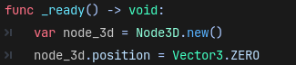
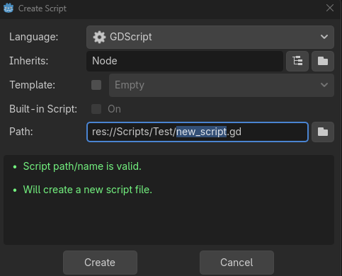
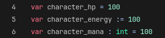
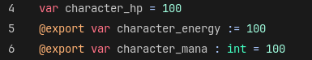
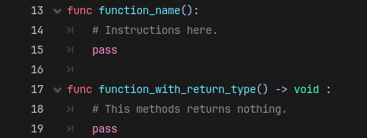
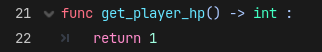
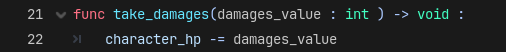

# Scripting GDSscript - Les bases

# La programmation orientée objet

Dans Godot, on va mettre en place une Programmation Orientée Objet (POO ou OOP en anglais), c’est à dire qu’on va avoir des classes qui nous permettront de définir des instances d’objets.
Ces objets seront responsables de fonctionnalités qui leur seront propres, et c’est la mise en place de leur interactions qui permettront de créer les différents comportement d’un jeu.

La classe sera donc le type de notre objet et elle contiendra les variables et les fonctions utilisées par l’objet ou les autres objets qui interagiront avec lui. 

## Comment utiliser un objet?

Dans Godot, on va pouvoir créer ou référencer un objet, et appeler des méthodes contenues dans sa classe.

Pour créer un objet, on va utiliser son **constructeur**, c’est une partie de son code qui sera appelée à son initialisation et qui va nous permettre d’avoir une référence vers notre objet.

Ici par exemple, on vient créer un nouveau Node3D (qui est un objet), en appelant son constructeur. Le point `.` nous permet d’accéder aux fonctions, aux variables ainsi qu’au constructeur présent dans la classe et de les appeler ou de les modifier. Dans cet exemple, on peut voir qu’on vient modifier la variable `position` du node3D pour lui donner la valeur `Vector3.ZERO` .

## L’héritage

En programmation orientée objet, on peut appliquer ce qu’on appelle de l’héritage, c’est à dire qu’on peut créer une classe qui va hériter des comportements d’une classe parent tout en lui permettant d’ajouter de nouveaux comportements propre à cette classe ou de préciser les comportements présents dans la classe parent.

Dans Godot, chaque script qu’on va créer va hériter d’une classe issue de la classe `GodotObject` , le plus souvent il s’agita d’un `Node`, d’un `Node2D`, d’un `Node3D` ou d’une `Resource` mais une classe peut hériter de n’importe quelle classe existante (que ça soit une classe de Godot, ou une classe qu’on a créé nous-même). 

> Attention : Une classe ne peut hériter que d’une seule classe parent !
> 

# Créer sa propre classe

Dans Godot, lorsqu’on va ajouter un nouveau script dans le projet, on va venir créer une nouvelle classe. Dans la fenêtre de FileSystem, contenant les assets présents dans le projet, si on fait un clic droit on peut accéder à un menu `Create New > Script…` afin d’ajouter un nouveau script au projet. Cette fenêtre va ensuite s’ouvrir : 

Ici, on va pouvoir renseigner plusieurs informations importantes relative à notre nouveau script : 

Dans le champ `Inherits` on va pouvoir spécifier sa classe parent, c’est à dire la classe dont les variables et les fonctions seront appliquées à notre nouvelle classe

Dans le champ `Path` on va venir entrer le nom de notre classe dans le projet. 

> Attention à bien garder des noms simples et cohérents avec l’objectif de votre classe
> 

Dans notre classe nouvellement créée, on va ensuite pouvoir ajouter des variables et des fonctions afin de pouvoir appliquer des comportements sur nos objets

## Les variables

Une variable va permettre de stocker des données dans la classe afin de les utiliser tout au long de la vie de notre objet. 

Ces données peuvent être très différentes, comme par exemple :

- Le nombre de points de vie d’un personnage
- La hitbox d’un personnage
- Le score du joueur
- etc…

On peut affecter des valeurs à ces variables et les modifier au cours du temps grâce à l’opérateur `=` .

Dans l’exemple ci-dessus, je déclare et initialise 3 variables de trois manière différentes :

- Je déclare la variable `character_hp` en lui affectant une valeur égale à `100` sans lui préciser un type de données, c’est à dire que cette variable pourra changer, et passer d’un entier à une chaine de caractères (ce qui peut être risqué et provoquer des bugs, évitez cette solution mais sachez qu’elle existe)
- Je déclare la variable `character_energy` en lui affectant une valeur égale à `100`en lui précisant un type de manière implicite, ici c’est le moteur qui va choisir le type le plus adapté selon la valeur à l’initialisation de la variable, et celui-ci restera le même.
- Je déclare la variable `character_mana` en lui affectant une valeur égale à `100` en lui précisant un type int de manière explicite, ici c’est moi qui choisi le type de la variable et il restera le même.

Si on souhaite accéder à une variable dans l’inspecteur du moteur de jeu (si par exemple on a plusieurs objets de la même classe qui ont des paramètres de base différents), on va pouvoir utiliser le mot clé `@export` pour rendre la variable visible dans l’inspecteur. Cependant il faudra préciser le type de la variable, que ça soit implicitement ou explicitement afin de permettre au moteur de créer le champ adapté au type de la variable dans l’inspecteur. 

### Quelques types de bases :

Dans Godot, et dans les langages de programmation en générale, on va retrouver des types de bases, qui vont le plus souvent être les types les plus communs. 

Les plus communs sont : 

- `bool` qui va représenter une valeur booléenne, c’est à dire vrai ou faux
- `int` qui va représenter un integer, c’est à dire les nombres entiers (aussi bien positif que négatif)
- `float` qui va représenter les nombres réels, notamment les décimales
- `String` qui va représenter une chaine de caractères
- `Vector2` qui va représenter un Vecteur en 2 dimensions (XY)
- `Vector3` qui va représenter un Vecteur en 3 dimensions (XYZ)

Mais il en existe d’autres qu’on peut retrouver [ici]([https://docs.godotengine.org/en/stable/tutorials/scripting/gdscript/gdscript_basics.html#built-in-types](https://docs.godotengine.org/en/stable/tutorials/scripting/gdscript/gdscript_basics.html#built-in-types))

## Les fonctions

Un fonction, lorsqu’elle va être appelée va exécuter les lignes de code une a une jusqu’à arriver à la fin des instructions qu’on lui a donné.

La déclaration d’une méthode se fait comme ci dessous : 

La fonction doit être déclaré avec le mot clé `func` suivi de son nom puis de parenthèses, puis terminer la ligne avec `:`. 

On peut également expliciter son type de retour avec `->` . Une fonction peut avoir un type de retour, ce qui permet de retourner une valeur d’un certain type à la fin de celle-ci. Par défaut elle retourne `void` qui est un type de retour vide. Dans le cas où elle retourne une valeur on utilisera le mot clé `return`.

Entre parenthèses, on va pouvoir spécifier des paramètres à la fonction, c’est à dire des variables locales à celle-ci qu’elle pourra utiliser dans ses instructions. Par exemple : 

# Les Fonctions propres aux Nodes :

Les classes de Godot possèdent des fonctions qui sont appelés par le moteur à des moments précis, en voici quelques exemples  : 

- `_ready` : appelé lorsque le Node est instancié dans la scene Tree et qu’il est prêt
- `_process` : appelé à toutes les frames lorsque le Node est instancié et présent sur la scène
    - le paramètre `delta` correspond à la durée entre la frame actuelle et la précédente (dépend donc du temps de rafraichissement)
- `_physics_process` : appelé à toutes les updates du moteur physique (permet de manipuler des objets qui sont dépendant du moteur physique, par exemple pour vérifier une collision celle-ci doit être à jour avec le moteur physique plutôt qu’avec le taux de rafraichissement)
- `_enter_tree` / `_exit_tree` : appelé lorsque le node est ajouté ou retiré de la scene
- `_input` : voir la page sur les inputs

# Resources utiles :

https://docs.godotengine.org/en/stable/tutorials/scripting/gdscript/gdscript_basics.html

https://gdquest.github.io/learn-gdscript/