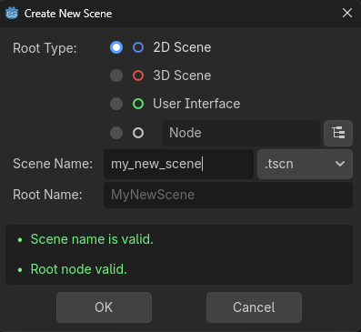
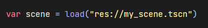
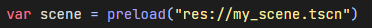
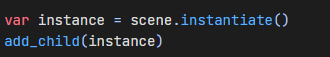

# Instanciation de Nodes

# Les Scenes

Dans Godot, les scènes sont des modèles enregistrées dans le projet, et elles peuvent être instanciées, en étant mise dans une scène en particulier (comme la scène principal qui est lancé au démarrage du jeu) ou via code.

# Comment créer une scène ?

On peut la créer à partir de noeuds existants déjà sur une scène ou en créer une à partir de rien.

Pour créer une scène à partir de rien, il suffit de faire un clic droit dans la fenêtre Project File et de sélectionner `Create New > Scene…` 

Une fois cette fenêtre ouverte, vous pourrez sélectionner le type de la racine de votre scène (2D, 3D, UI ou Node).

Vous devrez également lui donner un nom qui soit valide. 

> Il faut éviter les doublons et les caractères spéciaux que Godot ne pourrait pas prendre en compte.
Il faut aussi garder un nom cohérent pour pouvoir retrouver et différencier facilement les différentes scènes de votre projet.
> 

Le Root Name correspond au nome que portera la racine de votre projet dans la hiérarchie de la scène, il prend par défaut le nom de la scène mais il est possible de le modifier.

Dans le cas où vous souhaitez créer une scène à partir d’un Node parent déjà présent dans une scène, il suffit de faire un clic droit dessus et de sélectionner l’option `Save Branch as Scene…` puis de l’enregistrer sous le nom souhaité, à l’endroit souhaité dans le projet.

# Comment instancier une scène?

 En GDScript, il faut faire la différence entre un node (qui est déjà présent dans la scène) et une scène, qui peut être présente dans la scène, mais qui est également un asset sauvegardé dans notre projet.

Dans le cas où on souhaite instancier une scène qui est sauvegardé dans notre projet, il faut tout d’abord remplir un premier prérequis: 

## Charger une PackedScene:

En GD Script, pour référencer une Scène qu’on souhaite instancier, on utilise le type `PackedScene`

En effet, avant de pouvoir instancier une scène de notre projet, il faut tout d’abord la charger, on peut le faire de deux manières.

- Dans une fonction, on peut utiliser la méthode `load` afin de charger la scène, en précisant dans les paramètres, le chemin vers la scène.

- On peut également précharger la scène lorsqu’on déclare une variable de type `PackedScene` ce qui permet de charger la scène au moment de la compilation du script.

Le principal avantage de précharger sa scène, c’est qu’une fois celle-ci chargée, il n’y a plus besoin de la charger à nouveau, c’est à dire que s’il faut instancier plusieurs fois le même objet, on peut toujours utiliser la même `PackedScene` .

## Instancier la scène nouvellement chargée:

Une fois la scène chargée, on peut donc créer une nouvelle instance de ladite scène, il suffira ensuite de l’ajouter dans la `Scene Tree` afin qu’elle puisse être présente dans la scène et appliquer ses comportements. Pour se faire on va utiliser les méthodes `instantiate()` et `add_child()`. 

# Liens utiles :

> https://docs.godotengine.org/en/stable/tutorials/scripting/nodes_and_scene_instances.html#instancing-scenes
>