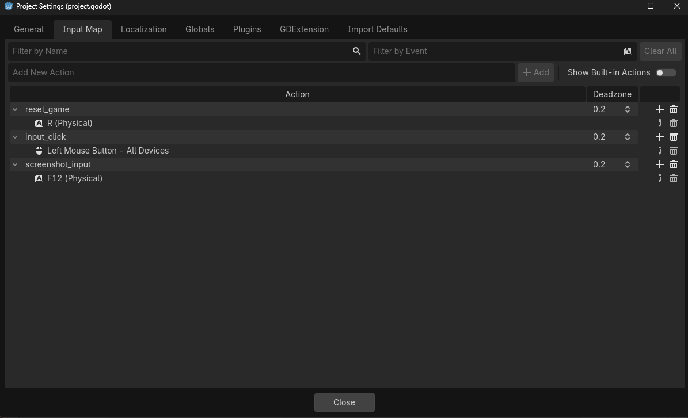

# Les Inputs dans Godot

# Input Maps

Dans Godot, on peut créer des Inputs Maps afin de stocker des Inputs Actions qu’on pourra ensuite utiliser dans le code. 
Pour accéder à l’Input Map, il faut aller dans le menu `Project > Project Settings > Input Map` , on peut ensuite ajouter de nouvelles Input Actions en entrant le nom de l’action dans le champ `Add New Action` et en appuyant ensuite sur le bouton `+ Add` .

Une Input Action va donc contenir deux informations : 

- Le nom de l’Input Action qu’on pourra utiliser dans le code.
- Les inputs liés à cette action.

Pour ajouter un input à une action, il faut appuyer sur le bouton `+` à droite du nom de l’Input Action. Une fenêtre va ensuite s’ouvrir où vous pourrez :

- Sélectionner l’input parmi ceux présents dans les différents menus déroulants (que ça soit un input du clavier, de la souris ou d’une manette).
- Si le champ en haut stipule `Listenning for Input` vous pouvez simplement appuyer sur l’input en question pour le sélectionner directement.

# Comment utiliser les Input Actions

Dans un script en GDScript, on peut ensuite récupérer l’information qu’un input a été pressé en utilisant l’une de ces deux méthodes :

- `func _input(event:InputEvent) → void:` lorsqu’on veut capturer un input dans toutes les circonstances.
- `func _unhandled_input(event: InputEvent) -> void` lorsqu’on veut capturer un input uniquement s’il n’a pas déjà été utilisé par un autre script (par exemple si un bouton est pressé et qu’on souhaite récupérer le clic de souris, cette méthode ne pourra pas capturer l’input car il a déjà été utilisé par le bouton).

Ces méthodes sont appelées automatiquement par le moteur de jeu dès lorsqu’un Input est pressé ou relâché.

Une fois dans la méthode, on peut ensuite appeler les méthodes:

- `is_action("action_name")` qui permet de retourner la valeur `true`lorsque l’input appartient à l’action donnée en paramètre, et ce qu’il soit pressé ou relâché.
- `is_action_pressed("action_name")` qui permet de retourner la valeur `true`lorsque l’input pressé appartient à l’action donnée en paramètre.
- `is_action_released("action_name")` qui permet de retourner la valeur `true`lorsque l’input relâché appartient à l’action donnée en paramètre.

Par exemple, on aura : 

# Autres moyens de capturer des inputs

Également, si le bouton n’est stocké dans aucune action, il est tout de même toujours capturé. On peut le voir car il est également possible de récupérer les informations relative à l’Input mais pour cela il faut connaitre le type de l’input parmi les types qui héritent de `InputEvent`. 

- `InputEventKey`pour les inputs au clavier, qu’on peut ensuite comparer à un KeyCode .
- `InputEventMouseButton`pour les clics de souris.
- `InputEventMouseMotion`pour les mouvements de la souris.
- `InputEventJoypadButton`pour les boutons des manettes.
- `InputEventJoypadMotion`pour les déplacements des sticks des manettes.

Il est également possible de convertir l’InputEvent APRÈS avoir vérifié qu’il appartenait bien à une action spécifique (si on veut avoir les déplacements d’un personnage gérés par une action `player_movement` qui permet de gérer les comportements au clavier ou à la manette par exemple). 

